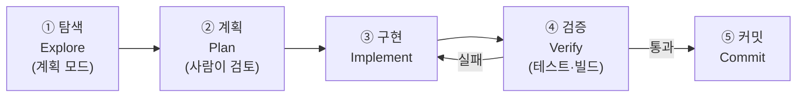

# 🔁 레벨 5: 핵심 작업 흐름 (탐색 → 계획 → 구현 → 검증 → 커밋)

> 🎯 **한 줄 요약:** 도우미에게 일을 맡길 때 **"먼저 둘러보고, 계획 세우고, 만들고, 채점하고, 저장하기"** 순서를 몸에 익혀요.

## ⏱️ 예상 기간

| 빠른 트랙 | 기본 트랙 | 여유 트랙 |
|---|---|---|
| 2주 | 3주 | 4주 |

← 이전: [레벨 4](04-레벨4-AI-코딩-에이전트-첫만남.md) · 다음: [레벨 6 개발자 기초 체력](06-레벨6-개발자-기초-체력.md) →

---

## ❓ 왜 배우나요?

- Claude Code 공식 문서는 **"Claude가 자기 일을 확인할 방법을 주는 것"** 을 **가장 효과가 큰 단 하나의 일**이라고 해요 (2026년 1월판 best-practices).
- 에이전트는 **"다 됐어요"라고 자신 있게 말하지만 틀릴 수 있어요.** 확인 수단이 없으면 우리는 믿고 넘어가게 돼요. (문서는 이걸 "믿고-확인 안 하는 틈(trust-then-verify gap)"이라는 실패 패턴으로 불러요.)
- 이 레벨의 습관이 레벨 6~9 전체의 바탕이에요.

---

## 📚 핵심 개념

### 1. 5단계 흐름과 계획 모드 (Plan mode)

- 🧒 **비유:** 레고로 큰 성을 만들 때 **① 상자 속 부품 보기 → ② 설명서 그리기 → ③ 조립 → ④ 설명서와 비교 → ⑤ 사진 찍어 두기.**
- 📖 **정확히:** Claude Code 문서(2026년 1월판)와 2025년 블로그는 **Explore → Plan → Implement → Commit**을 권해요. 이 교안은 여기에 **검증(Verify)** 을 따로 떼어 5단계로 가르쳐요.



**계획 모드 켜는 법** (고치지 않고 읽기·제안만 해요)

| 도구 | 방법 |
|---|---|
| Claude Code | `claude --permission-mode plan`, `Shift+Tab`으로 `⏸ plan mode on` 표시까지, 또는 `/plan 할일` |
| Codex | `/plan` 또는 `Shift+Tab`. 계획은 `<proposed_plan>` 블록(Summary / Key Changes / Test Plan / Assumptions)으로 나와요 |
| Cursor | `Shift+Tab`으로 Plan 모드 → 계획을 고친 뒤 **Build** 클릭. CLI는 `/plan`, `--mode=plan` [미러] |

**계획을 건너뛰어도 될 때:** Claude 문서 기준 "**바뀔 내용(diff)을 한 문장으로 설명할 수 있으면** 계획은 생략해요." Cursor 문서도 간단하거나 익숙한 일은 바로 Agent 모드로 하라고 해요.

**계획이 틀렸을 때:** Cursor 문서 [미러] 는 "결과가 원하는 것과 다르면, 후속 프롬프트로 고치려 애쓰지 말고 **변경을 되돌린 뒤 계획을 더 구체적으로 다듬어 다시 실행**하는 편이 대개 더 빠르다"고 해요.

### 2. 검증: "채점할 방법을 함께 주기"

- 🧒 **비유:** 숙제를 낼 때 **정답지(채점 기준)** 도 같이 줘요. 그러면 도우미가 스스로 채점하고 틀린 걸 고쳐요.
- 📖 **정확히:** 확인 수단(check)은 **테스트 파일, 빌드 성공 여부, 린터(lint), 결과 비교 스크립트, 화면 스크린샷 비교** 등이에요 (Claude 문서). MIT Missing Semester도 "모델이 **실패하는 검사를 직접 돌릴 수 있게** 피드백 루프를 만들어라"라고 해요.

**확인을 요구하는 방법 (약한 것 → 강한 것, Claude Code 기준)**

1. 프롬프트에 쓰기: "끝나면 auth 테스트를 돌리고, 통과할 때까지 계속해"
2. `/goal tests/auth의 모든 테스트가 통과하고 lint가 깨끗할 것` (Codex에도 `/goal`이 있어요, 0.128.0+)
3. Stop hook으로 강제하기 → [레벨 7](07-레벨7-도구-확장.md)
4. `/code-review`: 대화를 안 본 새 도우미가 diff를 검토

**증거를 달라고 하세요:** "실행한 명령과 그 출력 결과를 보여 줘."

**TDD(테스트 먼저 개발)를 에이전트와 하는 법** (2025 블로그, Missing Semester, roadmap.sh 공통)

```text
1. 입력/출력 예시로 테스트를 먼저 쓰게 한다 ("TDD 중이니 가짜 구현(mock)은 만들지 마")
2. 테스트를 돌려 "실패"하는 것을 확인한다 (아직 구현 코드는 쓰지 말라고 한다)
3. 테스트를 내가 읽고 확인한 뒤 커밋한다
4. "테스트 파일은 고치지 말고" 테스트가 통과할 때까지 구현하게 한다
5. 통과하면 커밋한다
```

### 3. 구체적으로 지시하기

- 🧒 **비유:** "맛있는 거 사 와" 대신 "편의점에서 **바나나우유 2개**, 5천 원 안으로, 없으면 딸기우유"라고 말해요.
- 📖 **정확히:** Claude Code 문서의 예시예요.

| 이렇게 말하지 말고 | 이렇게 말해요 |
|---|---|
| "로그인 버그 고쳐 줘" | "세션이 만료된 뒤 로그인이 실패한다는 신고가 있어. src/auth/의 토큰 갱신 부분을 보고, **재현하는 실패 테스트를 먼저 쓴 다음** 고쳐 줘" |
| "이메일 검사 함수 만들어 줘" | "validateEmail 함수를 만들어 줘. 예시: user@example.com은 true, invalid는 false, user@.com은 false. **구현 후 테스트를 실행해**" |
| "빌드가 실패해" | "빌드가 이 에러로 실패해: [에러]. 고치고 빌드가 성공하는지 확인해. **에러를 숨기지 말고 근본 원인을 고쳐**" |
| "캘린더 위젯 추가해 줘" | "HotDogWidget.php의 패턴을 따라 캘린더 위젯을 만들어 줘. **새 라이브러리는 쓰지 마**" |

추가 요령
- **범위를 좁혀요:** "foo.py에 대해, 로그아웃 상태인 경우를 다루는 테스트를 써 줘. mock은 쓰지 마."
- **참고할 곳을 알려줘요:** 기존 패턴, git 기록, 관련 파일(`@파일`).
- **증상을 설명해요:** 언제, 무엇을 하면, 무엇이 잘못되는지.
- **인터뷰를 시켜요:** "내가 원하는 걸 정확히 쓸 수 있을 때까지 나를 인터뷰하고, 그 결과를 SPEC.md에 써 줘." → **새 세션**에서 SPEC.md를 보고 만들게 해요.

### 4. 세션과 컨텍스트 관리 (책상 정리)

- 🧒 **비유:** 다른 숙제를 할 때는 **책상을 치우고** 새로 시작해요. 같은 숙제를 이어 할 때는 중요한 것만 **요약 메모**로 남겨요.
- 📖 **정확히:**

| 하고 싶은 일 | Claude Code | Codex | Cursor |
|---|---|---|---|
| 새로 시작 | `/clear [이름]` | `/new` | 새 채팅 |
| 요약해서 줄이기 | `/compact [남길 것]` | `/compact` | 가득 차면 자동 요약 |
| 사용량 보기 | `/context`, `/usage` | `/status` | 컨텍스트 링 |
| 되돌리기 | `/rewind`, `Esc Esc` | (git 사용) | Checkpoints |
| 이어서 하기 | `/rename 이름` → `claude --resume 이름`, `claude -c` | `codex resume`, `/resume` | `agent resume` (CLI) |
| 곁가지 질문 | `/btw` (기록에 안 남음) | | |
| 작업 중 끼어들기 | `Esc`로 멈춤 | `Enter` = 바로 끼어들기(steer), `Tab` = 끝나고 보낼 메시지 예약(queue) | `Enter` = 예약(queue), **Send now** = 끼어들기 |

**황금 규칙**
- **한 가지 일 = 한 대화(스레드).** 관련 없는 일을 섞지 않아요 (Codex best-practices, roadmap.sh).
- **2~3번 고쳐도 안 되면 새로 시작.** Claude 문서는 "두 번 고쳤는데 실패하면 `/clear`하고 **더 나은 프롬프트**를 써라", roadmap.sh는 "3번 실패하면 멈추고 새 채팅"이라고 해요.
- 관련 파일을 모르면 **@멘션을 억지로 하지 말고** 에이전트가 찾게 둬요 (Cursor 문서).

### 5. 안내 쪽지: CLAUDE.md · AGENTS.md · Cursor rules

- 🧒 **비유:** 새로 온 도우미에게 주는 **안내 쪽지**예요. "우리 집 규칙: 테스트는 이렇게 돌려요, 이 서랍은 열지 마세요." 매번 말로 하지 않아도 돼요.
- 📖 **정확히:**

| | Claude Code | Codex | Cursor |
|---|---|---|---|
| 파일 | `CLAUDE.md` 또는 `.claude/CLAUDE.md` (개인용 `CLAUDE.local.md`, 전역 `~/.claude/CLAUDE.md`) | `AGENTS.md` (전역 `~/.codex/AGENTS.md`) | `.cursor/rules/*.mdc`, `AGENTS.md` |
| 만들기 | `/init` | `/init` (200~400단어 "Repository Guidelines" 초안) | `/create-rule` |
| 크기 | **200줄 이하** 권장 | 최대 32KiB | 규칙 하나 **500줄 이하** |
| 여러 개면? | 상위 폴더부터 다 읽고 이어 붙임 (가까운 것이 마지막) | 루트→현재 폴더까지, **가까운 것이 우선** | 하위 폴더 AGENTS.md가 더 구체적이라 우선 |
| 서로 호환 | `CLAUDE.md`가 없으면 `AGENTS.md`를 읽어요 (v2.1.277+). 아니면 CLAUDE.md에서 `@AGENTS.md`로 불러와요 | | `AGENTS.md`를 읽어요 |

**무엇을 쓰나요?** (Claude·OpenAI 문서 공통)
- ✅ 정확한 **테스트·타입체크·린트 명령** (테스트 파일 하나만 돌리는 법 포함)
- ✅ 코드만 봐서는 **헷갈리는 곳**, 저장소에 없는 **팀 결정**
- ✅ **하지 말 것**과 **완료 정의(definition of done)**
- ✅ **두 번 이상 고쳐 준 실수** ("실수할 때마다 한 줄씩")
- ❌ 아키텍처 장문 설명, 대문자 "IMPORTANT!!" 강조 (현재 Claude 문서 기준 필요 없음)

> 예시 템플릿은 [11-치트시트](11-치트시트.md#claudemd--agentsmd-템플릿)에 있어요.

### 6. 요령은 바뀌어도 원칙은 남아요

- 🧒 **비유:** 게임 공략의 "꼼수"는 패치되면 사라지지만, **기본기**는 계속 통해요.
- 📖 **정확히:** Claude Code 문서는 2026년 11월판에서 **"이제 그만해도 되는 것(What you can stop doing)"** 표를 새로 넣었어요.

| (예전 방식) 요령 | 지금은? |
|---|---|
| 컨텍스트를 아주 공격적으로 관리하기 | 대부분 모델이 큰 컨텍스트 창을 갖고 자동 압축해요 (문서 기준) |
| IMPORTANT / 대문자로 강조하기 | 필요 없어요. 계속 무시되면 그 규칙은 **hook**으로 옮겨요 |
| "think hard / think harder"로 생각 깊이 조절 | **effort 수준**(`/effort`)으로 조절해요. `ultrathink`는 한 번의 턴에만 여전히 동작해요 |
| "계속해 / 게으름 피우지 마" | 필요 없어요 |
| 컨텍스트 아끼려고 subagent 쓰기 | subagent는 병렬 작업이나 **새로운 눈**이 필요할 때 써요 |
| CLAUDE.md에 아키텍처 설명하기 | 코드에서 알 수 없는 것만 적어요 |

현재 문서의 4가지 원칙: ① **Claude가 못 보는 것을 알려 줘라** ② **돌려 볼 검사를 줘라** ③ **예외가 없어야 하는 규칙은 강제하라**(hook, deny) ④ **기본값을 바꿔라.**

---

## 🛠️ 실습

> 준비: 연습 프로젝트를 만들어요.
> ```bash
> mkdir -p ~/ai-practice/todo-app && cd ~/ai-practice/todo-app
> git init
> python3 -m venv .venv && source .venv/bin/activate   # Windows: .venv\Scripts\activate
> pip install pytest
> echo ".venv/" > .gitignore && git add .gitignore && git commit -m "시작"
> ```

### 실습 1. 인터뷰 → SPEC.md (30분)

```text
터미널에서 쓰는 아주 간단한 할 일(TODO) 앱을 Python으로 만들고 싶어.
내가 원하는 걸 정확히 쓸 수 있을 때까지 질문을 하나씩 해서 나를 인터뷰해 줘.
인터뷰가 끝나면 SPEC.md에 요구사항, 하지 않을 것, 완료 기준을 정리해 줘. 코드는 아직 쓰지 마.
```

✅ **Done when:** SPEC.md에 "완료 기준"이 검증 가능한 문장(예: "`python3 todo.py add 우유`를 하면 목록에 우유가 생긴다")으로 3개 이상 있고, 커밋했어요.

### 실습 2. 계획 모드 훈련 (45분)

1. **새 세션**을 계획 모드로 시작해요: `claude --permission-mode plan` (또는 Codex `/plan`, Cursor Plan 모드)
2. 프롬프트:
```text
@SPEC.md 를 읽고 구현 계획을 세워 줘.
어떤 파일을 만들지, 어떤 테스트를 쓸지, 어떤 가정을 했는지 나눠서 적고 PLAN.md에 저장할 수 있게 보여 줘.
```
3. 계획의 **가정(Assumptions)** 중 틀린 것을 하나 찾아 고쳐요. (Claude Code에서는 `Ctrl+G`로 편집기에서 프롬프트를 고칠 수 있어요.)
4. 승인하고 구현시켜요:
```text
계획대로 구현해 줘. 각 기능마다 pytest 테스트를 쓰고, `python3 -m pytest`를 돌려서 실패하면 고쳐 줘.
마지막에 실행한 명령과 출력 결과를 보여 줘.
```
5. `git diff`를 읽고, 직접 `python3 -m pytest`를 돌려 확인한 뒤 커밋해요.

✅ **Done when:** 테스트가 내 컴퓨터에서 직접 통과했고, "계획 → 구현" 커밋이 남았어요.

### 실습 3. 막연한 지시 vs 구체적 지시 (40분)

1. 일부러 버그를 심어요: 할 일 삭제 기능에서 번호가 하나씩 밀리게(예: `index - 1`을 빼먹게) 바꾸고 커밋해요.
2. **세션 A:** "버그 고쳐 줘"라고만 말해요. 몇 번 주고받았는지, diff 크기를 적어요. 그리고 `git restore .`
3. **세션 B** (`/clear` 후):
```text
`python3 todo.py done 2`를 하면 2번이 아니라 3번 할 일이 완료돼.
todo.py의 done 처리 부분을 보고, 이 증상을 재현하는 실패 테스트를 먼저 tests/에 쓴 다음 고쳐 줘.
테스트 파일 말고 다른 파일은 꼭 필요한 곳만 고쳐 줘. 끝나면 pytest 결과를 보여 줘.
```

✅ **Done when:** A와 B의 "주고받은 횟수 / diff 줄 수 / 테스트 유무"를 비교한 표를 log.md에 썼어요.

### 실습 4. TDD 카타: 이메일 검사기 (45분)

```text
TDD로 할 거야. validate_email(s) 함수의 테스트만 먼저 tests/test_email.py에 써 줘.
예시: "user@example.com" → True, "invalid" → False, "user@.com" → False. 경우를 3개 더 추가해 줘.
가짜 구현(mock)은 만들지 말고, 구현 코드는 아직 쓰지 마. 테스트를 돌려서 실패하는 걸 보여 줘.
```
→ 테스트를 **내가 읽고** 이상한 예시가 없으면 커밋 →
```text
이제 테스트가 모두 통과할 때까지 validate_email을 구현해 줘. 테스트 파일은 절대 고치지 마.
```
→ `git diff tests/`가 비어 있는지 확인 → 커밋

✅ **Done when:** "테스트 커밋"과 "구현 커밋"이 따로 있고, 구현 커밋에서 테스트 파일이 바뀌지 않았어요.

### 실습 5. 안내 쪽지 만들기 (40분)

1. `/init`을 실행해요 (Claude Code는 CLAUDE.md, Codex는 AGENTS.md를 만들어요).
2. 결과를 **20줄 이하**로 줄여요: 명령어(설치, 테스트 전체, 테스트 하나), 규칙, 주의할 점만.
3. 커밋하고 **새 세션**을 열어 "삭제 기능에 테스트 하나 추가해 줘"라고만 말해요.
4. 에이전트가 **알려 주지 않았는데도** 쪽지에 적힌 테스트 명령을 쓰는지 봐요.
5. 에이전트가 같은 실수를 하면 쪽지에 **한 줄** 추가해요.

✅ **Done when:** 새 세션이 내가 말하지 않은 테스트 명령을 스스로 썼어요. (Claude Code는 `/context`나 `/memory`로 쪽지가 읽혔는지 확인할 수 있어요.)

### 실습 6. 책상 정리 실험 (30분)

1. 한 세션에서 관련 없는 일 두 개(예: README 고치기 + 새 기능)를 연달아 시켜요. `/usage`(또는 `/context`)를 기록해요.
2. 다시, 일 하나 끝날 때마다 `/clear` 하고 같은 두 일을 시켜요. 사용량을 비교해요.
3. 긴 세션에서 `/compact 테스트 명령과 SPEC 결정 사항은 남겨 줘`를 써 봐요.
4. 일부러 이상한 변경을 시킨 뒤 `Esc Esc`(또는 `/rewind`)로 되돌려 봐요.

✅ **Done when:** 두 방식의 사용량 비교와 느낀 점을 log.md에 적었어요.

---

## 🏁 마일스톤 체크리스트: 🔁 검증하는 습관

다 체크하면 [레벨 6](06-레벨6-개발자-기초-체력.md)으로 가요.

- [ ] 계획 모드로 계획 → 수정 → 구현 → 커밋을 끝까지 1번 이상 했다
- [ ] "테스트 커밋 → 구현 커밋" TDD 기록이 git log에 1세트 이상 있다
- [ ] 막연한 지시 vs 구체적 지시 비교 표를 만들었다
- [ ] 20줄 이하 CLAUDE.md 또는 AGENTS.md가 있고, 새 세션이 그걸 따랐다
- [ ] 2~3번 실패 후 "새로 시작 + 더 나은 프롬프트"로 해결한 경험이 1번 이상 있다
- [ ] 에이전트에게 "실행한 명령과 출력"을 증거로 받고, 내가 같은 명령을 직접 돌려 확인했다
- [ ] **AI 없이** 5단계 흐름과 "계획을 건너뛰어도 될 때"를 설명할 수 있다
- [ ] 🧠 문제를 답을 보지 않고 4개 이상 맞혔다

---

## 🧠 스스로 확인 문제

1. Claude Code 문서가 꼽은 "가장 효과가 큰 단 하나의 일"은?
2. 계획을 건너뛰어도 되는 경우는?
3. 에이전트와 TDD를 할 때, 구현 단계에서 꼭 붙이는 말은?
4. 같은 버그를 두 번 고쳐 달라고 했는데 여전히 실패하면?
5. CLAUDE.md/AGENTS.md에 꼭 들어가야 할 것 두 가지와, 넣지 말아야 할 것 하나는?

<details><summary>정답 보기</summary>

1. Claude가 자기 일을 확인할 방법(테스트, 빌드, 린트 등)을 주는 것.
2. 바뀔 내용(diff)을 한 문장으로 설명할 수 있을 만큼 작고 분명한 일일 때.
3. "테스트 파일은 고치지 마." (테스트를 바꿔서 통과시키는 꼼수를 막아요)
4. 세 번째로 또 고치라고 하지 말고, `/clear`(새 대화) 후 더 구체적인 프롬프트를 써요. 계획이 틀렸다면 되돌리고 계획부터 다시 다듬어요.
5. 넣을 것: 정확한 테스트·린트 명령, 헷갈리는 곳·하지 말 것·반복 실수. 넣지 말 것: 긴 아키텍처 설명, 대문자 강조 같은 "주문".

</details>

---

## ⚠️ 흔한 실수 (Claude 문서의 실패 패턴 포함)

| 실수 | 이렇게 해요 |
|---|---|
| **잡동사니 세션** (kitchen-sink): 한 대화에 이것저것 | 일 하나 끝나면 `/clear` |
| **같은 걸 계속 고쳐 달라고** 하기 | 2번 실패하면 새로 시작 + 더 나은 프롬프트 |
| **너무 긴 안내 쪽지** | 200줄 이하, 명령어 위주 |
| **믿고 확인 안 함** | 증거(명령+출력) 요구, 직접 실행 |
| **끝없는 탐색**: "조사해 줘"만 하고 범위 없음 | 범위를 좁히거나 subagent에게 맡기기 |
| 큰 작업을 계획 없이 시작 | 계획 모드부터 |
| 테스트를 안 읽고 커밋 | 테스트가 **내가 원하는 것**을 검사하는지 먼저 확인 (Missing Semester: "테스트를 감사(audit)하라") |
| 리뷰를 시키면 사소한 스타일 지적만 잔뜩 | "정확성에 영향을 주는 문제만, **스타일은 빼고**"라고 말하기 |

---

## 🔗 자료

**🇰🇷 한국어**
- 🇰🇷 CC101 Claude Code 한국어 입문: https://github.com/fivetaku/cc101

**공식·미러 문서**
- Claude Code 현재 best-practices (미러): https://raw.githubusercontent.com/ericbuess/claude-code-docs/main/docs/best-practices.md
- Claude Code 2026년 1월판 best-practices (탐색/계획/구현/커밋, 실패 패턴): https://raw.githubusercontent.com/ericbuess/claude-code-docs/20c58c7f7a820f257f392d86607a122210200dcb/docs/best-practices.md
- Claude Code `memory.md`, `common-workflows.md`: https://github.com/ericbuess/claude-code-docs
- 2025년 블로그 "Claude Code: Best practices for agentic coding" 사본 (예전 자료): https://github.com/disler/claude-code-is-programmable
- Codex 계획 모드 템플릿: https://github.com/openai/codex/blob/main/codex-rs/collaboration-mode-templates/templates/plan.md
- Codex `/init` 프롬프트: https://github.com/openai/codex/blob/main/codex-rs/tui/assets/prompt_for_init_command.md
- AGENTS.md 표준: https://github.com/agentsmd/agents.md
- Codex·ChatGPT best-practices 미러 [미러]: https://github.com/ai-native-engineer/openai-mirror
- Cursor `rules.md`, `agent/plan-mode.md` 미러 [미러]: https://github.com/life-is-blue/cursor-docs-mirror
- Cursor 공식 규칙 예시: https://github.com/cursor/plugins/blob/main/cursor-team-kit/rules/no-inline-imports.mdc

**더 읽기**
- MIT Missing Semester 2026 "Agentic Coding": https://github.com/missing-semester/missing-semester/blob/master/_2026/agentic-coding.md
- roadmap.sh vibe-coding (계획 먼저, 한 번에 하나, 3번 실패하면 새 채팅): https://github.com/nilbuild/developer-roadmap
- ykdojo/claude-code-tips: https://github.com/ykdojo/claude-code-tips
