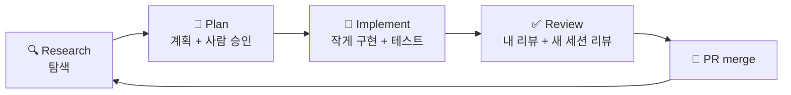

# 🎓 레벨 9: 개발자 수준 졸업 (설계 · 리뷰 · 판단 · 배포 · 캡스톤)

> 🎯 **한 줄 요약:** 이제 나는 **현장 감독**이에요. 도우미가 지은 집을 **설계도와 비교해서 검사하고**, 안전하고 튼튼한지 **판단**하고, 사람들이 **실제로 살 수 있게** 내놓아요.

## ⏱️ 예상 기간

| 빠른 트랙 | 기본 트랙 | 여유 트랙 |
|---|---|---|
| 4주 | 6주 | 8주 |

← 이전: [레벨 8](08-레벨8-자동화와-병렬-작업.md) · 다음: [연구와 논문](10-연구와-논문.md) →

---

## ❓ 왜 배우나요?

- 레벨 8까지 배운 건 **도구 쓰는 법**이에요. 개발자는 여기에 **판단**을 더해요: *무엇을 만들지, 이 코드가 괜찮은지, 안전한지, 비용은 적당한지, 어떻게 내놓을지.*
- MIT Missing Semester 2026은 AI 결과물을 쓸 때 이렇게 경고해요: "정확성과 **보안 버그**를 확인하라. 때로는 코드를 **검증하는 게 직접 쓰는 것보다 어렵다**. 디버깅 소용돌이를 조심하라. AI를 **목발로 쓰지 마라**. 컴퓨팅 사고력은 여전히 가치 있다."
- roadmap.sh "Vibe Coder Mindset": AI는 **옆자리 주니어 개발자** 같아요. 내 역할은 **지휘하는 사람**으로 바뀌어요. 그래도 **프로그래밍 기초는 알아야** 해요.

---

## 📚 핵심 개념

### 1. 설계와 명세 (Spec-Driven Development)

- 🧒 **비유:** 집을 지을 때 **설계도부터** 그려요. 설계도 없이 "멋진 집 지어 줘"라고 하면 도우미마다 다른 집을 지어요.
- 📖 **정확히:** 코드를 쓰기 전에 **무엇을, 왜, 어떻게 확인할지**를 문서(SPEC.md, PLANS.md)로 먼저 정해요.

| 방법 | 핵심 흐름 | 출처 |
|---|---|---|
| ACE-FCA (HumanLayer) | **Research → Plan → Implement**, 중요한 지점마다 사람이 검토, 컨텍스트 사용률 약 **40~60%** 유지 | humanlayer/advanced-context-engineering-for-coding-agents |
| superpowers | 아이디어 다듬기 → 명세를 **읽기 쉬운 조각으로 승인** → "열정적인 주니어도 따라 할 만큼 명확한" 구현 계획 → red/green TDD, YAGNI → subagent 실행 | obra/superpowers |
| Spec Kit | 명세 주도 개발(SDD) 도구 모음 | github/spec-kit |
| Claude Code 공식 | "나를 **인터뷰**해서 SPEC.md를 써 줘" → **새 세션**에서 SPEC.md로 구현 (레벨 5) | Claude Code best-practices |
| Codex ExecPlan | PLANS.md에 Progress, Surprises & Discoveries, Decision Log, Outcomes & Retrospective를 **살아 있는 문서**로 유지 | openai-cookbook |

### 2. 코드 리뷰 (사람의 눈)

- 🧒 **비유:** 친구가 쓴 받아쓰기를 **채점**하는데, "글씨 예쁘네"보다 "**틀린 글자**"를 찾는 게 중요해요.
- 📖 **정확히:** diff를 읽고 **정확성, 보안, 테스트, 읽기 쉬움**을 확인해요. 에이전트가 만든 코드는 특히 **"AI 찌꺼기(AI slop)"** 를 확인해요.

| 리뷰 체크 | 질문 |
|---|---|
| 정확성 | 명세대로 동작해요? 경계값(빈 값, 아주 큰 값)은요? |
| 테스트 | 테스트가 **진짜로** 동작을 확인해요? 에이전트가 테스트를 **약하게 고치지는** 않았나요? |
| 보안 | 비밀 키, 입력 검증, 권한 |
| AI slop (Cursor `deslop` 스킬 기준) | 쓸데없는 주석, 이상한 방어 코드나 과한 try/catch, `any` 캐스팅, 너무 깊은 중첩 |
| 범위 | 부탁하지 않은 파일까지 고쳤나요? |

참고: google/eng-practices(코드 리뷰 가이드), Codex 리뷰 루브릭(**이번 변경이 만든, 고칠 수 있는 버그만**).

### 3. 판단력: 보안 · 비용 · 품질

- 🧒 **비유:** 운전을 배우면 **운전 기술**보다 **"지금 가도 되나?"** 판단이 더 중요해져요.
- 📖 **정확히:**

| 판단 | 확인할 것 | 도구 |
|---|---|---|
| 🔒 보안 | 비밀은 환경 변수로, `.env`는 gitignore와 deny 규칙, YOLO 모드는 **격리된 VM·컨테이너에서만**. Cursor 문서: "Auto-review는 **보안 경계가 아니다**" | Claude `/security-review`, 보안 리뷰 액션, deny 규칙, 샌드박스 |
| 💰 비용 | 세션마다 사용량 확인, 자동화에는 한도 설정, 간단한 일은 가벼운 모델로 | Claude `/usage`(별칭 `/cost`), `--max-budget-usd`, subagent `model: haiku`, Cursor 리뷰 Quick vs Deep |
| ✅ 품질 | 구조와 검증이 자율성보다 중요해요 (Agentless 연구) | 테스트, CI, 리뷰 |
| ⏱️ 생산성 | **"빨라진 느낌"은 증거가 아니에요.** 직접 측정해요 (METR 연구) | 작업 시간 기록표 |

### 4. 배포 (Shipping)

- 🧒 **비유:** 만든 그림을 내 서랍에만 두지 않고 **학교 게시판에 거는** 거예요.
- 📖 **정확히:** 내 컴퓨터에서만 돌던 프로그램을 **다른 사람도 쓸 수 있게** 패키지로 만들거나 서버에 올려요.
  - MIT Missing Semester 2026 강의 "Packaging and Shipping Code"(`_2026/shipping-code.md`)
  - roadmap.sh `ai-product-builder` 로드맵의 배포 관련 노드: deployment, vercel, railway, render, supabase, cloudflare, unit-testing, e2e-testing
  - 서비스마다 무료 범위와 방법이 **자주 바뀌어요.** 각 서비스 공식 문서를 확인하세요 (확인 필요).

### 5. Agent SDK (선택: 나만의 에이전트 만들기)

- 🧒 **비유:** 지금까지는 **완성된 로봇**을 썼다면, 이제 **로봇 조립 키트**로 나만의 로봇을 만들어요.
- 📖 **정확히:** Claude Agent SDK는 Claude Code의 에이전트 루프를 **내 프로그램 안에서** 쓰게 해 줘요.
  - Python: `pip install claude-agent-sdk` (Python 3.10+)
  - TypeScript: `npm install @anthropic-ai/claude-agent-sdk`
  - 예제: anthropics/claude-cookbooks의 `claude_agent_sdk/` 노트북 (리서치 에이전트, 비서 에이전트, SRE 등)

### 6. 포트폴리오와 공개 학습 (Learn in Public)

- 🧒 **비유:** **그림일기**를 모아 두면 내가 얼마나 컸는지 **나도, 다른 사람도** 볼 수 있어요.
- 📖 **정확히:** swyx "Learn In Public": 배운 것을 **기록하고 공유**하면 가장 큰 덕을 보는 건 **미래의 나**예요. 예: Simon Willison의 `simonw/til`(오늘 배운 것), `simonw/tools`(LLM으로 만든 작은 도구들 + 사용한 프롬프트 기록).

---

## 🛠️ 실습

### 실습 1. 리뷰 근육 키우기: deslop (60분)

1. `todo-app`에서 에이전트에게 새 기능을 맡겨요: "할 일 마감일(due date) 기능을 추가하고 테스트해 줘."
2. **내가 먼저** 위 "리뷰 체크" 표로 diff를 리뷰하고 문제를 적어요.
3. 그다음 에이전트에게:
```text
main 대비 이번 diff에서 AI가 만든 불필요한 코드를 찾아 줘:
쓸데없는 주석, 과한 try/catch나 방어 코드, 불필요하게 깊은 중첩.
동작은 바꾸지 말고 정리한 다음 테스트를 실행해서 그대로 통과하는지 보여 줘.
```
4. 내 목록과 에이전트 목록을 비교해요.

✅ **Done when:** 정리 전후 테스트가 모두 통과하고, 내가 찾은 문제 목록이 log.md에 있어요.

### 실습 2. 보안 감사 (45분)

1. Claude Code에서 `/security-review` 실행 (또는 프롬프트: "이 저장소의 보안 문제를 찾아 줘. 비밀 키 하드코딩, 입력 검증, 위험한 명령 실행을 확인하고 파일:줄로 알려 줘.")
2. 각 지적이 **진짜 문제인지** 내가 판단해요(진짜 / 오탐 / 애매).
3. 진짜 문제 1개를 **테스트 먼저** 쓰고 고쳐요.

✅ **Done when:** 판단표(지적 / 진짜·오탐 / 이유)와, 고친 문제의 테스트가 있어요.

### 실습 3. 비용과 시간 측정 (일주일 동안 틈틈이)

작업할 때마다 기록해요.

| 날짜 | 작업 | 예상 시간 | 실제 시간 | AI 사용 방식 (🔴/🟡/🟢) | 사용량 (`/usage` 등) | 다시 고친 횟수 |
|---|---|---|---|---|---|---|
| | | | | | | |

✅ **Done when:** 5개 이상 기록하고 "AI가 진짜 도움이 된 작업 / 아니었던 작업"을 3줄로 정리했어요.

### 실습 4. (선택) Agent SDK로 작은 에이전트 (60분)

```bash
cd ~/ai-practice && mkdir sdk-hello && cd sdk-hello
python3 -m venv .venv && source .venv/bin/activate
pip install claude-agent-sdk
```
```python
# hello_agent.py
import asyncio
from claude_agent_sdk import query

async def main():
    async for message in query(prompt="이 폴더에 있는 파일 목록을 알려 줘"):
        print(message)

asyncio.run(main())
```
옵션(`ClaudeAgentOptions`)으로 쓸 수 있는 도구나 권한을 제한하는 방법은 claude-agent-sdk-python README에서 확인해요.

✅ **Done when:** 스크립트가 실행돼 메시지가 출력되고, 옵션 하나를 README에서 찾아 적용했어요.

### 실습 5. 🎓 캡스톤 프로젝트 (3~5주)

**주제 고르기:** 내가 **진짜 쓸** 작은 프로그램 (예: 가계부 웹앱, 공부 시간 기록기, 동아리 일정 API). 새 저장소로 시작해요.

**필수 요구사항**

| # | 요구사항 | 증거 |
|---|---|---|
| 1 | 인터뷰 → `SPEC.md` (목표, 기능, 완료 기준, 하지 않을 것) | SPEC.md |
| 2 | `PLANS.md` 또는 계획 문서 (진행 상황, 결정 기록 포함) | PLANS.md |
| 3 | `AGENTS.md` 또는 `CLAUDE.md` (실행·테스트 명령, 규칙) | 파일 |
| 4 | 자동 테스트 **10개 이상**, 모두 통과 | 테스트 결과 |
| 5 | GitHub Actions CI(테스트 자동 실행) | 초록색 체크 |
| 6 | 모든 기능은 **브랜치 → PR → 리뷰 → merge** (PR 5개 이상) | PR 목록 |
| 7 | 에이전트 리뷰 + **내 리뷰 코멘트**가 각 PR에 있음 | PR 코멘트 |
| 8 | 보안 점검(`/security-review` 등) 결과와 조치 기록 | log.md |
| 9 | 비밀 키는 코드에 없음 (`.env` + `.gitignore`) | 저장소 |
| 10 | README: 무엇인지, 설치·실행·테스트 방법, 스크린샷 또는 예시 | README.md |
| 11 | 배포 또는 패키징 (다른 사람이 써 볼 수 있음) | 링크 또는 설치 방법 |
| 12 | `AI-LOG.md`: 어떤 일을 어떤 모드(🔴/🟡/🟢)로 했고, 무엇을 고쳤고, 무엇을 배웠는지 | 파일 |

**진행 방법 (ACE-FCA 흐름)**


✅ **Done when:** 12개 요구사항 표의 "증거" 칸이 모두 링크나 파일로 채워졌어요.

### 실습 6. 🧪 최종 "AI 없이" 확인 (90분)

AI 도구를 **모두 끄고** 해요. (인출 연습. 결과보다 **내가 어디서 막히는지** 아는 게 목적이에요.)

1. 캡스톤 코드에서 아무 함수 하나를 골라 **말로 설명**하기 (파인만 기법)
2. 작은 기능 1개(예: 입력 검증 하나)를 **직접** 구현하고 테스트 1개 쓰기
3. 일부러 넣은 버그 하나(친구가 넣어 주거나, 커밋 하나를 되돌려 만들기)를 **traceback과 print만으로** 찾기
4. 브랜치 → 커밋 → PR을 **명령어만으로** 만들기

✅ **Done when:** 4개 중 3개 이상을 해냈고, 막힌 부분을 복습 계획에 넣었어요.

### 실습 7. 포트폴리오 정리 (2~3시간)

- [ ] GitHub 프로필 README에 캡스톤과 대표 프로젝트 2~3개 링크
- [ ] 각 프로젝트 README에 "무엇을, 왜, 어떻게(사용한 AI 도구와 방식)"
- [ ] TIL 저장소 또는 블로그 글 3개 이상 (예: "에이전트에게 TDD 시키기", "worktree로 병렬 작업", "AI 리뷰 vs 내 리뷰")
- [ ] 100일 챌린지 log.md 공개 ([13-진도표](13-진도표.md))
- [ ] 회고: 처음(레벨 0)과 지금 비교 3줄

✅ **Done when:** 다른 사람이 내 GitHub만 보고 "이 사람이 무엇을 할 수 있는지" 알 수 있어요.

---

## 🏁 마일스톤 체크리스트: 🎓 개발자 졸업

- [ ] 캡스톤 12개 요구사항을 모두 증거와 함께 채웠다
- [ ] PR 5개 이상에 **내가 쓴** 리뷰 코멘트가 있다
- [ ] 보안 점검 결과를 진짜/오탐으로 판단하고 1개 이상 고쳤다
- [ ] 시간·비용 기록표 5개 이상으로 "AI가 도움 된 일 / 아닌 일"을 정리했다
- [ ] 배포 링크 또는 설치 방법으로 **다른 사람 1명 이상**이 내 프로그램을 실행해 봤다
- [ ] **AI 없이** 최종 확인 4개 중 3개 이상 해냈다
- [ ] 포트폴리오 체크리스트를 다 채웠다
- [ ] 🧠 문제를 답을 보지 않고 4개 이상 맞혔다

🎉 **축하해요!** 이제 AI 코딩 에이전트를 **지휘하고 검증하는 개발자**예요. 공부는 여기서 끝나지 않아요. 도구는 계속 바뀌니까 [연구와 논문](10-연구와-논문.md)과 공식 문서를 주기적으로 다시 읽어요.

---

## 🧠 스스로 확인 문제

1. Research → Plan → Implement에서 사람이 꼭 검토해야 하는 곳은 어디고, 왜 그런가요?
2. 에이전트가 만든 diff에서 찾아야 할 "AI slop" 3가지는?
3. "에이전트 쓰니까 훨씬 빨라진 느낌이야"가 증거가 될 수 없는 이유는? (METR 연구)
4. YOLO(모든 권한 허용) 모드를 써도 되는 환경은?
5. 캡스톤에서 테스트와 CI가 왜 필수인가요?

<details><summary>정답 보기</summary>

1. 계획(Plan)을 승인할 때예요. 잘못된 계획 한 줄이 코드 수백 줄의 실수가 되니까, 영향이 가장 큰 지점에서 사람이 확인해요.
2. 쓸데없는 주석, 과한 try/catch나 방어 코드, `any` 캐스팅, 너무 깊은 중첩 (그리고 부탁하지 않은 범위의 변경).
3. METR 연구에서 개발자들은 AI 덕분에 빨라졌다고 **느꼈지만**, 실제로는 약 19% 느렸어요. 느낌이 아니라 기록으로 측정해야 해요.
4. 격리된 VM이나 컨테이너처럼, 망가져도 괜찮고 비밀 정보가 없는 환경이에요.
5. 에이전트가 스스로 결과를 확인할 수 있는 피드백 루프가 되고, 나와 다른 사람이 "정말 동작하는지"를 매번 자동으로 확인할 수 있어서예요.

</details>

---

## ⚠️ 흔한 실수

| 실수 | 이렇게 해요 |
|---|---|
| 캡스톤 주제를 너무 크게 잡음 | 2주 안에 "동작하는 가장 작은 버전"을 먼저 merge |
| 명세 없이 바로 구현 | 인터뷰 → SPEC.md → 계획 승인 → 구현 |
| 에이전트 리뷰만 믿고 내 리뷰 생략 | 내 리뷰 먼저, 에이전트 리뷰는 비교용 |
| 보안 리뷰 결과를 다 고침 (또는 다 무시) | 진짜/오탐을 **판단**하고 이유를 적기 |
| 비용 확인 안 함 | `/usage` 확인, 자동화에는 한도 |
| AI 없이 하는 연습을 건너뜀 | 주 1회 "AI 끄고" 연습 (Bastani 연구: AI를 빼면 성적이 떨어질 수 있어요) |
| 포트폴리오에 결과만 올림 | **과정**(계획, PR, 회고, AI-LOG)을 같이 보여 주기 |

---

## 🔗 자료

**🇰🇷 한국어**
- 🇰🇷 신입 개발자 면접 질문 (기초 CS 복습): https://github.com/jbee37142/Interview_Question_for_Beginner
- 🇰🇷 CC101 Claude Code 한국어 입문: https://github.com/fivetaku/cc101
- 🇰🇷 100일 코딩 도전 규칙 (한국어): https://github.com/kallaway/100-days-of-code/tree/master/intl/ko

**설계·방법론**
- ACE-FCA: https://github.com/humanlayer/advanced-context-engineering-for-coding-agents/blob/main/ace-fca.md
- superpowers: https://github.com/obra/superpowers
- Spec Kit: https://github.com/github/spec-kit
- 12-Factor Agents: https://github.com/humanlayer/12-factor-agents
- MIT Missing Semester 2026 (Agentic Coding, Packaging and Shipping Code): https://github.com/missing-semester/missing-semester

**리뷰·보안**
- Google 코드 리뷰 가이드: https://github.com/google/eng-practices
- Codex 리뷰 루브릭: https://github.com/openai/codex/blob/main/codex-rs/prompts/templates/review/rubric.md
- Cursor `deslop` 스킬: https://github.com/cursor/plugins/blob/main/cursor-team-kit/skills/deslop/SKILL.md
- Claude 보안 리뷰 액션: https://github.com/anthropics/claude-code-security-review

**SDK**
- https://github.com/anthropics/claude-agent-sdk-python
- https://github.com/anthropics/claude-agent-sdk-typescript
- https://github.com/anthropics/claude-cookbooks

**공개 학습·로드맵**
- roadmap.sh (ai-product-builder, vibe-coding 등): https://github.com/nilbuild/developer-roadmap
- swyx "Learn In Public": https://github.com/swyxio/swyxdotio/issues/103
- Simon Willison TIL / tools: https://github.com/simonw/til · https://github.com/simonw/tools
- Cursor `teaching` 플러그인 (학습 경로, 학습 회고): https://github.com/cursor/plugins/tree/main/teaching
