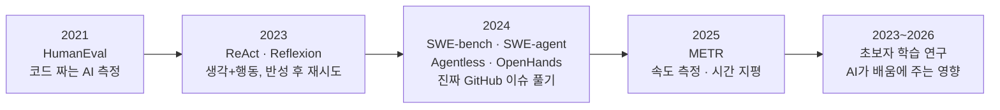

# 📄 연구와 논문: AI 코딩 에이전트를 과학으로 이해하기

← 이전: [레벨 9](09-레벨9-개발자-수준-졸업.md) · 다음: [치트시트](11-치트시트.md) →

> 🎯 **한 줄 요약:** "AI가 좋대!", "AI 쓰면 바보 된대!" 같은 **소문** 대신, 사람들이 **실험해서 알아낸 것**을 봐요.

> ⚠️ **읽기 전에 꼭 알아 두기**
> - 조사일: **2026-11-01**. arXiv와 metr.org는 이 조사 환경에서 직접 열리지 않았어요. 그래서 **공식 GitHub 저장소**(README, 인용 정보)와 **2차 자료**(논문을 요약한 다른 저장소)로 확인했어요.
> - 표시: ✅ = 공식 저장소에서 확인 · **(2차)** = 다른 사람의 요약에서 확인 · ⚠️ = 원문 확인 필요
> - 숫자는 **그 논문의 실험 조건에서만** 맞아요. 모델이 빨리 바뀌어서 오늘의 성능 숫자는 금방 낡아요. **숫자보다 교훈**을 기억하세요.

---

## 🧭 한눈에 보기

| 묶음 | 질문 | 우리에게 주는 교훈 한 줄 |
|---|---|---|
| ① 에이전트와 벤치마크 | AI가 코드를 얼마나 잘 짜나? 어떻게 하면 더 잘하나? | **도구·구조·피드백(테스트)** 이 모델만큼 중요해요 |
| ② 개발자 생산성 | AI가 정말 일을 빠르게 하나? | **상황에 따라 달라요.** 느낌 말고 **측정**해요 |
| ③ 초보자 학습 | AI가 배우는 데 도움이 되나, 해가 되나? | **선생님 모드**로 쓰고, **AI 없이** 자주 확인해요 |
| ④ 컨텍스트·프롬프트 | AI에게 무엇을 어떻게 보여 줘야 하나? | **적고, 관련 있는** 정보가 좋아요 |

---

## ① 에이전트와 벤치마크

### HumanEval / Codex — "Evaluating Large Language Models Trained on Code"
- **연도:** 2021 (arXiv 2107.03374), Chen 외
- 🧒 **쉬운 요약:** AI에게 파이썬 문제를 내고 **채점 테스트**로 맞혔는지 확인하는 시험지(HumanEval)를 만들었어요. 한 번에 맞힌 비율은 **28.8%**, 100번 시도해서 하나라도 맞으면 정답으로 치면 **70.2%** 였어요.
- 💡 **교훈:** **여러 번 시도 + 테스트로 확인**하면 성공률이 확 올라가요. 그래서 우리는 에이전트에게 **테스트를 돌리게** 해요.
- 🔗 ✅ https://github.com/openai/human-eval · 숫자 (2차) https://github.com/Jack47/hack-SysML/blob/master/papers/NLP/codex.md

### ReAct — "Synergizing Reasoning and Acting in Language Models"
- **연도:** ICLR 2023 (arXiv 2210.03629), Yao 외
- 🧒 **쉬운 요약:** AI가 **생각하고 → 행동하고 → 결과를 보고 → 다시 생각**하게 했더니, 생각만 하거나 행동만 할 때보다 잘했어요. (ALFWorld 과제에서 71% 대 행동만 45%)
- 💡 **교훈:** 이 "생각↔행동" 반복이 **모든 코딩 에이전트의 조상**이에요. 레벨 4의 에이전트 루프(정보 모으기 → 행동 → 확인)가 바로 이거예요.
- 🔗 ✅ https://github.com/ysymyth/ReAct · 숫자 (2차) https://github.com/jmagly/aiwg/blob/main/docs/references/REF-018-react-reasoning-acting.md

### Reflexion — "Language Agents with Verbal Reinforcement Learning"
- **연도:** NeurIPS 2023 (arXiv 2303.11366), Shinn 외
- 🧒 **쉬운 요약:** 실패하면 AI가 **"반성 일기"** 를 쓰고 기억했다가 다시 시도해요. HumanEval에서 91%(비교 기준 80%).
- 💡 **교훈:** "**테스트 실패를 보여 주고 다시 하게 하기**" 패턴의 근거예요 (레벨 5 TDD).
- 🔗 ✅ https://github.com/noahshinn/reflexion · 숫자 (2차) https://github.com/jmagly/aiwg/blob/main/docs/references/REF-021-reflexion-verbal-reinforcement.md

### SWE-bench — "Can Language Models Resolve Real-World GitHub Issues?"
- **연도:** ICLR 2024 (arXiv 2310.06770), Jimenez 외
- 🧒 **쉬운 요약:** 장난감 문제 말고 **진짜 GitHub 이슈** 2,294개(파이썬 저장소 12개)를 풀게 했어요. 처음 나왔을 때 가장 잘한 모델(Claude 2)도 **1.96%** 만 풀었어요.
- 💡 **교훈:** 진짜 코드베이스는 **훨씬 어려워요.** 그 뒤 에이전트 연구는 이 시험을 기준으로 빠르게 발전했어요.
- 🔗 ✅ https://github.com/SWE-bench/SWE-bench · 숫자 (2차) https://github.com/athlonk8/cs329z/blob/main/source/content/Jimenez2024_SWE-bench_ICLR2024.md

### SWE-agent — "Agent-Computer Interfaces Enable Automated Software Engineering"
- **연도:** NeurIPS 2024 (arXiv 2405.15793), Yang 외
- 🧒 **쉬운 요약:** AI용으로 **쓰기 편한 도구**(파일 보기, 편집, 검색 명령)를 만들어 줬더니 SWE-bench를 **12.5%** 풀었어요. 이전 방법보다 훨씬 높았어요.
- 💡 **교훈:** **도구와 환경 설계가 모델만큼 중요해요.** 우리가 CLAUDE.md, 테스트 명령, MCP를 잘 준비하는 이유예요.
- 🔗 ✅ https://github.com/SWE-agent/SWE-agent

### mini-SWE-agent
- **연도:** 2025 (저장소)
- 🧒 **쉬운 요약:** 약 **100줄**짜리 파이썬 에이전트인데 SWE-bench Verified에서 **74% 넘게** 풀어요(저장소 설명 기준. README의 7월 소식에는 65%로 적혀 있어요).
- 💡 **교훈:** 에이전트의 핵심 루프는 **생각보다 단순해요.** 레벨 4에서 이 저장소를 직접 둘러봤죠.
- 🔗 ✅ https://github.com/SWE-agent/mini-swe-agent

### Agentless — "Demystifying LLM-based Software Engineering Agents"
- **연도:** 2024 (arXiv 2407.01489), Xia 외
- 🧒 **쉬운 요약:** 자유롭게 돌아다니는 에이전트 대신 **정해진 3단계**(문제 위치 찾기 → 고치기 → 확인하기)만 했더니, 당시 오픈소스 중 최고(SWE-bench Lite **27.3%**)였고 이슈당 평균 **$0.34**로 저렴했어요.
- 💡 **교훈:** **구조와 작업 흐름이 자율성보다 나을 때가 많아요.** 레벨 5의 탐색→계획→구현→검증이 이 생각과 같아요.
- 🔗 ✅ https://github.com/OpenAutoCoder/Agentless

### OpenHands — "An Open Platform for AI Software Developers as Generalist Agents"
- **연도:** 2024 (arXiv 2407.16741), Wang 외
- 🧒 **쉬운 요약:** 코드 쓰기, 터미널, 웹 브라우저를 다 쓰는 **오픈소스 코딩 에이전트 플랫폼**이에요(예전 이름 OpenDevin).
- 💡 **교훈:** 에이전트 내부를 **직접 열어 보고 배울 수 있는** 공개 프로젝트예요.
- 🔗 ✅ https://github.com/OpenHands/OpenHands

### METR 시간 지평 — "Measuring AI Ability to Complete Long Tasks"
- **연도:** 2025 (arXiv 2503.14499)
- 🧒 **쉬운 요약:** "사람이 몇 분(몇 시간) 걸리는 일을 AI가 해낼 수 있나?"를 쟀더니, 그 길이가 **약 7개월마다 두 배**로 늘고 있었어요.
- 💡 **교훈:** 도구가 **아주 빨리** 좋아져요. 그래서 이 교안은 **오래가는 원칙**(검증, 구체성, 새 컨텍스트)을 가르치고, 세부 기능은 공식 문서로 다시 확인하라고 해요.
- 🔗 ✅ https://github.com/METR/eval-analysis-public

---

## ② 개발자 생산성 연구

### Peng 외 — "The Impact of AI on Developer Productivity: Evidence from GitHub Copilot"
- **연도:** 2023 (arXiv 2302.06590)
- 🧒 **쉬운 요약:** 프로그래머 95명에게 **같은 과제 하나**(JavaScript로 HTTP 서버 만들기)를 줬더니, Copilot을 쓴 그룹이 **55.8% 더 빨리** 끝냈어요(95% 신뢰구간 21~89%).
- ⚠️ **주의:** 과제가 **하나**뿐이고, 작고 명확한 **새 프로젝트**였어요. 저자들이 GitHub/Microsoft 소속이에요.
- 🔗 (2차) https://github.com/lhl/realitycheck-data/blob/main/analysis/sources/peng-2023-copilot-productivity.md

### METR RCT — "Measuring the Impact of Early-2025 AI on Experienced Open-Source Developer Productivity"
- **연도:** 2025-07 (arXiv 2507.09089), Becker · Rush · Barnes · Rein
- 🧒 **쉬운 요약:** 경험 많은 개발자들이 **자기가 잘 아는 큰 오픈소스 저장소**의 진짜 이슈 246개를 풀었어요. AI를 허용했더니 오히려 **약 19% 더 느려졌어요**(회귀 결과 0.188, 신뢰구간 약 0.013~0.39).
- (2차) 개발자는 16명이었고, 시작 전에는 24% 빨라질 거라 **예상**했고, 끝난 뒤에도 약 20% 빨라졌다고 **느꼈대요.**
- 🔗 ✅ https://github.com/METR/Measuring-Early-2025-AI-on-Exp-OSS-Devs · (2차) https://github.com/ashutosh-rath02/atrophy/blob/main/docs/research.md

### 🤔 두 연구는 서로 반대일까요?

**아니에요.** 조건이 달라요.

| | Peng (2023) | METR (2025) |
|---|---|---|
| 일의 종류 | 작고 명확한 **새** 과제 1개 | 크고 오래된 **진짜** 저장소의 이슈 |
| 사람 | 다양한 프로그래머 | 그 저장소를 **잘 아는 전문가** |
| 결과 | 55.8% 빠름 | 약 19% 느림 |

💡 **교훈:** 작고 명확한 일에서는 AI가 크게 도와줄 수 있고, 내가 이미 잘 아는 복잡한 코드에서는 오히려 느려질 수 있어요. **"빨라진 느낌"은 증거가 아니에요. 직접 재 보세요** (레벨 9 실습 3의 시간 기록표).

---

## ③ 초보자 학습 연구 (이 교안에 가장 중요해요)

### Kazemitabaar 외 — "Studying the Effect of AI Code Generators on Supporting Novice Learners in Introductory Programming"
- **연도:** CHI 2023 (arXiv 2302.07427)
- 🧒 **쉬운 요약:** **10~17살** 초보자 69명이 파이썬 과제 45개를 했어요. AI(Codex)를 쓴 그룹은 완료율이 **1.15배**, 점수가 **1.8배** 높았고, **AI 없이 코드를 고치는 실력도 떨어지지 않았어요.** 원래 실력(Scratch 경험)이 있는 학생이 더 큰 도움을 받았어요.
- 💡 **교훈:** 초보자도 AI로 배울 수 **있어요.** 단, 기초가 있을수록 더 잘 배워요.
- 🔗 ✅ https://github.com/uoftcsed/uoftcsed.github.io/blob/master/_pubs/bibs/Kazemitabaar.bib

### Prather 외 — "The Widening Gap: The Benefits and Harms of Generative AI for Novice Programmers"
- **연도:** ICER 2024
- 🧒 **쉬운 요약:** 학생 21명을 관찰했더니, **원래 잘하던 학생**은 AI로 더 빨라졌지만, **어려워하던 학생**은 더 헷갈리고 **"나 이거 할 줄 알아"라는 착각(illusion of competence)** 만 남았어요.
- 💡 **교훈:** AI가 **실력 차이를 더 벌릴 수 있어요.** 그래서 "AI 없이 다시 해 보기"로 착각을 깨야 해요.
- 🔗 (2차) https://github.com/ian-ludden/csse220-genai-guide/blob/v4/content/The%20Widening%20Gap%20-%20The%20Benefits%20and%20Harms%20of%20Generative%20AI%20for%20Novice%20Programmers.md

### Bastani 외 — "Generative AI without guardrails can harm learning: Evidence from high school mathematics"
- **연도:** PNAS 2025
- 🧒 **쉬운 요약:** 고등학생 약 1,000명. 제한 없는 GPT-4를 쓴 학생들은 연습 때는 잘했지만, **AI를 뺏자 17% 더 못했어요.** 그런데 **답을 바로 안 주는 선생님 모드** AI는 이런 피해가 없었어요. (수학 연구지만 코딩에도 그대로 적용돼요.)
- 💡 **교훈:** 배울 때는 **🔴 선생님 모드**로 써요 ([00-시작하기](00-시작하기-학습법.md)).
- 🔗 (2차) https://github.com/ashutosh-rath02/atrophy/blob/main/docs/research.md

### Anthropic — "How AI assistance impacts the formation of coding skills" ⚠️
- **연도:** 2026
- 🧒 **쉬운 요약:** 엔지니어 52명이 처음 보는 파이썬 라이브러리를 배웠어요. 걸린 시간은 비슷했지만, AI 그룹은 이해도 퀴즈 점수가 더 낮았어요(약 50% 대 67%). 특히 **디버깅**에서 차이가 컸고, **통째로 맡긴** 사람이 **질문하며 쓴** 사람보다 더 손해를 봤어요.
- ⚠️ 원문 페이지를 직접 열지 못했어요. 숫자는 2차 자료 기준이니 **확인 필요**예요.
- 🔗 (2차) https://github.com/ashutosh-rath02/atrophy/blob/main/docs/research.md

### 📌 세 연구를 합치면

| 이렇게 하면 😊 | 이렇게 하면 😟 |
|---|---|
| 질문하며 배우기 (선생님 모드) | 답만 받아 복사하기 |
| 기초를 먼저 쌓고 AI로 가속하기 | 기초 없이 AI에 기대기 |
| 정기적으로 **AI 없이** 다시 해 보기 (인출 연습) | "할 줄 안다"는 느낌만 믿기 |
| 이미 잘하는 일은 🟢 맡기기 | 배우는 중인 일까지 🟢 맡기기 |

> 💬 **The Odin Project의 반대 의견:** "학습에 AI 도구를 쓰는 것을 **추천하지 않는다**." 이유: 빈틈이 생기고, 좋은 질문을 하는 법을 늦게 배우고, 초보자는 결과가 좋은지 판단할 수 없고, 면접에서는 AI를 못 쓸 수 있어요. 이 교안은 이 경고를 진지하게 받아들여 **🔴/🟡/🟢 규칙**과 **"AI 없이" 마일스톤**을 넣었어요.

---

## ④ 컨텍스트·프롬프트 연구

| 제목 | 연도 | 🧒 쉬운 요약 | 💡 교훈 | 🔗 출처 |
|---|---|---|---|---|
| **Lost in the Middle: How Language Models Use Long Contexts** (Liu 외) | 2023, arXiv 2307.03172 | 긴 글에서 AI는 **처음과 끝**은 잘 쓰고 **가운데**는 잘 놓쳐요 | 책상에 자료를 **많이**보다 **딱 필요한 것만** 올려요 | ✅ https://github.com/nelson-liu/lost-in-the-middle |
| **A Survey of Context Engineering for Large Language Models** | 2025-07, arXiv 2507.13334 | 프롬프트(말하는 내용)를 넘어 **AI가 보는 모든 것**(예시, 기억, 도구, 상태)을 설계하는 분야 정리 | CLAUDE.md, rules, MCP가 모두 "컨텍스트 설계"예요 | ✅ https://github.com/Meirtz/Awesome-Context-Engineering |
| **The Prompt Report** (Schulhoff 외) | arXiv 2406.06608 | 프롬프트 기법들을 체계적으로 정리한 조사 | 기법 이름보다 **목표·맥락·제약·완료 기준**이 핵심 | ✅ Meirtz/Awesome-Context-Engineering 목록 |
| **A Systematic Survey of Prompt Engineering in LLMs** (Sahoo 외) | arXiv 2402.07927 | 프롬프트 엔지니어링 기법과 활용 조사 | 같음 | ✅ Meirtz/Awesome-Context-Engineering 목록 |
| **A Survey on Language Models for Code** | TMLR 2024, arXiv 2311.07989 | 코드 AI 연구 전체 지도 | 더 깊이 공부하고 싶을 때 출발점 | ✅ https://github.com/codefuse-ai/Awesome-Code-LLM |

---

## 🧠 스스로 확인 문제

1. Agentless 연구가 알려 주는 "구조 vs 자율성" 교훈은?
2. Peng 연구(55.8% 빠름)와 METR 연구(약 19% 느림)가 모순이 아닌 이유는?
3. Bastani 연구에서 피해가 없었던 AI 사용 방식은?
4. "Lost in the Middle"이 컨텍스트 관리에 주는 교훈은?
5. 이 페이지의 숫자를 볼 때 조심해야 할 점 2가지는?

정답 보기

1. 정해진 단계(위치 찾기 → 고치기 → 확인)만으로도 자유로운 에이전트보다 잘하고 저렴할 수 있어요. 좋은 작업 흐름이 중요해요.
2. 조건이 달라요. Peng은 작고 명확한 새 과제 하나, METR은 전문가가 잘 아는 크고 복잡한 진짜 저장소예요. 상황마다 효과가 다르니 직접 측정해야 해요.
3. 답을 바로 주지 않는 선생님 모드(가드레일이 있는 튜터)예요.
4. 많은 정보를 넣는다고 좋은 게 아니에요. 중요한 정보는 적고 관련 있게, 필요하면 새 세션으로 정리해요.
5. ① 그 실험 조건에서만 맞는 숫자이고 모델이 빨리 바뀌어요. ② 일부는 2차 자료나 확인 필요 상태예요.

---

## 🔗 더 찾아보기 (논문 목록 저장소)

- 코드 LLM 연구: https://github.com/codefuse-ai/Awesome-Code-LLM
- 컨텍스트 엔지니어링: https://github.com/Meirtz/Awesome-Context-Engineering
- 프롬프트 엔지니어링 가이드 (dair-ai): https://github.com/dair-ai/Prompt-Engineering-Guide
- AI 에이전트 목록: https://github.com/e2b-dev/awesome-ai-agents
- LLM 에이전트 논문 목록: https://github.com/WooooDyy/LLM-Agent-Paper-List
- 교육 분야 LLM: https://github.com/GeminiLight/awesome-ai-llm4education · https://github.com/Geralt-Targaryen/Awesome-Education-LLM

전체 출처와 확인 상태는 [14-출처](14-출처.md)에 있어요.
