# 🤖 AI 코딩 에이전트 교안: 왕초보에서 개발자 수준까지

> **한 줄 소개:** Claude Code, OpenAI Codex/ChatGPT, Cursor 같은 **AI 코딩 도우미(AI coding agent)** 를 잘 쓰는 법을 배우는 교안이에요.
> 컴퓨터를 처음 만지는 사람도 따라올 수 있게, **초등학생도 이해할 수 있는 말**로 썼어요.

- 📅 자료 조사 날짜: **2026-11-01**
- 🗣️ 언어: 한국어. 기술 용어는 괄호 안에 영어로 함께 적었어요.
- ⚠️ AI 도구는 아주 빨리 바뀌어요. 명령어가 안 되면 먼저 **`/help`, `--help`, 공식 문서**를 확인하세요.

---

## 1. 이 교안은 누구를 위한 건가요?

| 이런 분께 맞아요 | 이 교안을 마치면 |
|---|---|
| 코딩을 거의 처음 해 보는 사람 | 터미널, Python, git을 직접 쓸 수 있어요 |
| ChatGPT는 써 봤지만 "코딩 에이전트"는 낯선 사람 | Claude Code, Codex, Cursor에게 **일을 맡기고 결과를 검증**할 수 있어요 |
| AI가 짠 코드를 믿어도 되는지 불안한 사람 | 테스트, diff 읽기, 코드 리뷰로 **스스로 판단**할 수 있어요 |
| 개발자처럼 일하고 싶은 사람 | 캡스톤 프로젝트와 포트폴리오를 가지고 졸업해요 |

### 핵심 생각 하나

> AI 코딩 에이전트는 **똑똑하지만 우리 프로젝트 사정을 모르는 인턴(신입 도우미)** 이에요.
> 우리는 **일을 잘 설명하고, 결과를 확인하는 반장**이 되어야 해요.

이 비유는 여러 공식 자료에 공통으로 나와요. MIT Missing Semester 2026의 "인턴을 관리하는 매니저", ChatGPT 프롬프트 가이드의 "새 인턴에게 일 넘기기", Cursor 문서의 "똑똑하지만 맥락이 부족한 사람 개발자"가 모두 같은 이야기예요. 자세한 출처는 [14-출처.md](14-출처.md)에 있어요.

---

## 2. 전체 로드맵 한눈에 보기

### 2-1. 레벨 표

| 레벨 | 파일 | 무엇을 배우나요? | 마일스톤 이름 | 빠른 트랙 | 기본 트랙 | 여유 트랙 |
|---|---|---|---|---|---|---|
| 0 | [00-시작하기-학습법](00-시작하기-학습법.md) | 공부하는 방법, 루틴 만들기 | 🧭 출발 준비 | 2일 | 3일 | 1주 |
| 1 | [01-레벨1-컴퓨터와-AI-친해지기](01-레벨1-컴퓨터와-AI-친해지기.md) | 파일·폴더·터미널, AI와 대화하는 법 | 🐣 터미널 첫 인사 | 1주 | 2주 | 3주 |
| 2 | [02-레벨2-파이썬-코딩-기초](02-레벨2-파이썬-코딩-기초.md) | Python 기초, 에러 읽기, AI를 선생님으로 | 🐍 첫 프로그램 | 3주 | 4주 | 6주 |
| 3 | [03-레벨3-git과-github](03-레벨3-git과-github.md) | 세이브 포인트(commit), branch, PR, diff | 💾 첫 세이브 포인트 | 1주 | 2주 | 3주 |
| 4 | [04-레벨4-AI-코딩-에이전트-첫만남](04-레벨4-AI-코딩-에이전트-첫만남.md) | 설치, 첫 실행, 권한·샌드박스 | 🤝 에이전트와 첫 악수 | 1주 | 1주 | 2주 |
| 5 | [05-레벨5-핵심-작업-흐름](05-레벨5-핵심-작업-흐름.md) | 탐색→계획→구현→검증→커밋, 안내 쪽지 | 🔁 검증하는 습관 | 2주 | 3주 | 4주 |
| 6 | [06-레벨6-개발자-기초-체력](06-레벨6-개발자-기초-체력.md) | HTTP/API, 테스트, 디버깅, 코드 읽기, 보안 | 🧰 개발자 기초 체력 | 3주 | 4주 | 6주 |
| 7 | [07-레벨7-도구-확장](07-레벨7-도구-확장.md) | MCP, skills, hooks, subagents, 규칙 | 🧩 나만의 도구 상자 | 2주 | 2주 | 3주 |
| 8 | [08-레벨8-자동화와-병렬-작업](08-레벨8-자동화와-병렬-작업.md) | headless, GitHub Actions, worktree, 긴 작업(`/goal`) | ⚙️ 혼자 일하는 에이전트 | 1주 | 2주 | 3주 |
| 9 | [09-레벨9-개발자-수준-졸업](09-레벨9-개발자-수준-졸업.md) | 설계, 리뷰, 보안·비용 판단, 배포, 캡스톤 | 🎓 개발자 졸업 | 4주 | 6주 | 8주 |
| | | | **합계** | **약 4.5개월** | **약 6개월** | **약 9개월** |

| 트랙 | 일주일 공부 시간 | 추천 대상 |
|---|---|---|
| 🏃 빠른 트랙 | 주 12~15시간 | 시간이 많거나 코딩을 조금 해 본 사람 |
| 🚶 기본 트랙 | 주 7~10시간 (평일 1시간 + 주말 2시간) | 대부분의 직장인·학생 |
| 🐢 여유 트랙 | 주 5~6시간 | 바쁜 사람, 천천히 확실하게 가고 싶은 사람 |

> 💡 처음 설계할 때는 단계를 10개(컴퓨터 기초 / AI 대화를 따로)로 나눴어요. 둘 다 짧고 서로 이어져서 **레벨 1 하나로 합쳤어요.** 그래서 레벨 번호와 파일 번호가 같아요.
> 기간은 **예상**일 뿐이에요. 더 걸려도 괜찮아요. **마일스톤 체크리스트를 다 채우면** 다음 레벨로 가요.

### 2-2. 로드맵 그림

```mermaid
flowchart LR
    S["0. 🧭 출발 준비<br/>학습법"] --> L1["1. 🐣 터미널 첫 인사<br/>컴퓨터·AI 친해지기"]
    L1 --> L2["2. 🐍 첫 프로그램<br/>Python 기초"]
    L2 --> L3["3. 💾 첫 세이브 포인트<br/>git·GitHub"]
    L3 --> L4["4. 🤝 에이전트와 첫 악수<br/>설치·권한"]
    L4 --> L5["5. 🔁 검증하는 습관<br/>핵심 작업 흐름"]
    L5 --> L6["6. 🧰 개발자 기초 체력<br/>API·테스트·디버깅"]
    L6 --> L7["7. 🧩 나만의 도구 상자<br/>MCP·skills·hooks"]
    L7 --> L8["8. ⚙️ 혼자 일하는 에이전트<br/>자동화·병렬"]
    L8 --> L9["9. 🎓 개발자 졸업<br/>캡스톤"]
```



mermaid 그림이 안 보이는 환경을 위한 글자 그림이에요.

```text
[기초 다지기]                [에이전트 다루기]               [개발자 되기]
 0 출발 준비                  4 🤝 첫 악수                   7 🧩 도구 상자
 1 🐣 터미널 첫 인사   ──▶    5 🔁 검증하는 습관    ──▶      8 ⚙️ 자동화·병렬
 2 🐍 첫 프로그램             6 🧰 개발자 기초 체력          9 🎓 졸업(캡스톤)
 3 💾 첫 세이브 포인트
   (1~2개월)                    (2~3개월)                      (2~3개월)
```

### 2-3. 왜 이 순서인가요?

1. **기초 먼저.** 에이전트는 터미널 명령을 실행하고 파일을 고쳐요. 내가 읽을 줄 모르면 "허락해도 될까?"를 판단할 수 없어요.
2. **git은 안전망.** 에이전트가 망쳐도 세이브 포인트로 돌아가면 돼요. 그래서 에이전트보다 git을 먼저 배워요.
3. **검증이 핵심.** Claude Code 공식 문서는 "Claude가 자기 일을 확인할 방법을 주는 것"을 가장 효과가 큰 일로 꼽아요. 그래서 레벨 5와 6에서 테스트와 검증을 깊게 다뤄요.
4. **확장과 자동화는 나중에.** 기본 흐름이 몸에 익은 뒤에 배워야 사고가 안 나요.

---

## 3. 이 교안 사용법

### 3-1. 하루 학습 흐름 (1시간 기준)

```text
⏱️ 5분   어제 배운 것 떠올리기 (책 덮고! = 인출 연습)
⏱️ 10분  레벨 파일의 📚 핵심 개념 읽기
⏱️ 30분  🛠️ 실습 따라 하기 (Done when까지)
⏱️ 10분  🧠 스스로 확인 문제 풀기 (AI 없이!)
⏱️ 5분   log.md에 기록하기 (오늘 한 일 / 막힌 곳 / 내일 할 일)
```

- 25분 공부 + 5분 휴식(뽀모도로)으로 나눠도 좋아요. → [00-시작하기-학습법](00-시작하기-학습법.md)
- 복습 날짜(1일/3일/7일/14일/30일)는 [13-진도표](13-진도표.md)에 적어요.

### 3-2. 레벨 파일은 모두 같은 모양이에요

| 칸 | 뜻 |
|---|---|
| 🎯 한 줄 요약 | 초등학생 비유로 한 문장 |
| ⏱️ 예상 기간 | 빠른/기본/여유 트랙 기준 |
| ❓ 왜 배우나요? | 이걸 모르면 생기는 문제 |
| 📚 핵심 개념 | 비유 → 정확한 설명 (3~6개) |
| 🛠️ 실습 | 따라 하는 단계 + **Done when(완료 조건)** |
| 🏁 마일스톤 체크리스트 | 다 체크하면 다음 레벨로! |
| 🧠 스스로 확인 문제 | 답은 접혀 있어요. 먼저 스스로 떠올려 보세요 |
| ⚠️ 흔한 실수 | 많이들 하는 실수 |
| 🔗 자료 | 더 공부할 곳 (🇰🇷 = 한국어 자료) |

### 3-3. 세 가지 약속

1. **연습용 폴더에서만 실험해요.** 중요한 파일이 있는 곳에서 에이전트를 돌리지 않아요.
2. **AI가 "다 됐어요"라고 해도 직접 확인해요.** 테스트를 돌리고, diff를 읽어요.
3. **AI 없이 하는 시간도 꼭 가져요.** 그래야 진짜 실력이 쌓여요. 이유는 [10-연구와-논문](10-연구와-논문.md)에 있어요.

---

## 4. 파일 목차

| 파일 | 내용 |
|---|---|
| [README.md](README.md) | 지금 보는 소개 파일 |
| [00-시작하기-학습법.md](00-시작하기-학습법.md) | 마음가짐, 전문가 공부법, AI 사용 균형 규칙, 주간 루틴, 복습 주기, 번아웃 방지 |
| [01-레벨1-컴퓨터와-AI-친해지기.md](01-레벨1-컴퓨터와-AI-친해지기.md) | 파일·폴더·경로, 터미널, 프롬프트 기본, 환각과 검증 |
| [02-레벨2-파이썬-코딩-기초.md](02-레벨2-파이썬-코딩-기초.md) | 변수·조건·반복·함수, 에러 메시지, AI 선생님 모드 |
| [03-레벨3-git과-github.md](03-레벨3-git과-github.md) | commit, branch, diff, PR, 되돌리기 |
| [04-레벨4-AI-코딩-에이전트-첫만남.md](04-레벨4-AI-코딩-에이전트-첫만남.md) | Claude Code·Codex·Cursor 설치와 첫 실행, 권한 비교 |
| [05-레벨5-핵심-작업-흐름.md](05-레벨5-핵심-작업-흐름.md) | 계획 모드, 검증, 구체적 지시, 컨텍스트 관리, CLAUDE.md·AGENTS.md·rules |
| [06-레벨6-개발자-기초-체력.md](06-레벨6-개발자-기초-체력.md) | HTTP/API/JSON, 테스트, 디버깅, 코드 읽기, 보안 |
| [07-레벨7-도구-확장.md](07-레벨7-도구-확장.md) | MCP, skills, hooks, subagents, 슬래시 명령, 플러그인 |
| [08-레벨8-자동화와-병렬-작업.md](08-레벨8-자동화와-병렬-작업.md) | `claude -p`, `codex exec`, GitHub Actions, worktree, Writer/Reviewer |
| [09-레벨9-개발자-수준-졸업.md](09-레벨9-개발자-수준-졸업.md) | 설계, 코드 리뷰, 보안·비용·품질 판단, 배포, 캡스톤, 포트폴리오 |
| [10-연구와-논문.md](10-연구와-논문.md) | METR, Copilot, 초보자 학습 연구, SWE-bench 등 |
| [11-치트시트.md](11-치트시트.md) | 도구별 명령표, 프롬프트 템플릿, CLAUDE.md/AGENTS.md 예시 |
| [12-용어사전.md](12-용어사전.md) | 초등학생 말로 푼 용어 사전 |
| [13-진도표.md](13-진도표.md) | 체크박스 진도표, 100일 챌린지 표, 주간 회고 |
| [14-출처.md](14-출처.md) | 모든 출처와 확인 상태 |

---

## 5. 원래 출처와 이 교안이 실제로 쓴 자료

### 5-1. 원래 출처 (학습자가 처음 알려 준 링크)

아래 사이트는 조사 환경에서 **접속이 막혀 있었어요.** 그래서 같은 내용을 담은 **GitHub 미러(복사본)와 공식 GitHub 저장소**로 내용을 확인했어요. 여러분은 직접 들어가서 최신 내용을 꼭 확인하세요.

| 원래 출처 | 이 교안에서 대신 확인한 곳 |
|---|---|
| claude.dev | (내용 확인 못 함) → Claude Code 공식 저장소 https://github.com/anthropics/claude-code |
| claude.com/ko/resources | (내용 확인 못 함) → 한국어 입문서 https://github.com/fivetaku/cc101 등 |
| code.claude.com/docs/en/best-practices | 문서 미러 https://github.com/ericbuess/claude-code-docs (`docs/best-practices.md`) |
| cursor.com/ko/blog | (블로그 본문 미러 없음) → Cursor 문서 미러 https://github.com/life-is-blue/cursor-docs-mirror , 공식 https://github.com/cursor/plugins |
| developers.openai.com/blog | 미러 https://github.com/ai-native-engineer/openai-mirror (`developers.openai.com/blog/...`) |
| developers.openai.com/cookbook/topic/codex | 공식 https://github.com/openai/openai-cookbook , 미러 `developers.openai.com/cookbook/topic/codex.md` |
| learn.chatgpt.com/guides/best-practices | 미러 https://github.com/ai-native-engineer/openai-mirror (`learn.chatgpt.com/guides/best-practices.md`) |

> ⚠️ **미러는 공식이 아니에요.** 원본과 다를 수 있어요. 이 교안에서 미러로만 확인한 내용은 [14-출처.md](14-출처.md)에 `[미러]` 라고 표시했어요.

### 5-2. 이 교안을 믿어도 되나요?

- 명령어와 기능은 **조사 노트에서 확인된 것만** 넣었어요.
- 확인이 안 된 것은 **(확인 필요)**, 지금은 안 쓰는 방법은 **(예전 방식)** 이라고 적었어요.
- 모델 이름은 일부러 거의 안 적었어요. 금방 바뀌기 때문이에요. 각 도구 안에서 `/model` 같은 명령으로 확인하세요.

---

## 6. 시작하기

👉 **[00-시작하기-학습법.md](00-시작하기-학습법.md)** 부터 읽고, 그다음 **[레벨 1](01-레벨1-컴퓨터와-AI-친해지기.md)** 로 가세요.
👉 진도는 **[13-진도표.md](13-진도표.md)** 에 체크하세요.
